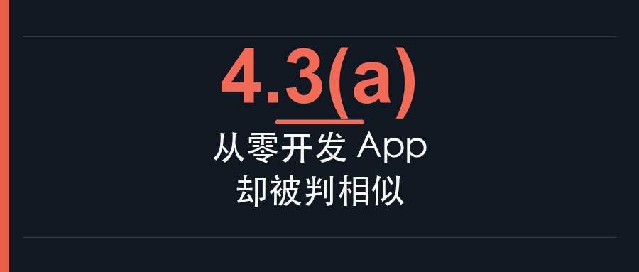

# 听途 4.3(a) 文章封面示例

这篇文章讨论一个从零开发的 App 被以 4.3(a) 相似性理由拒审，作者没有拿到具体比对依据。封面选择正文中真实的拒审代码 `4.3(a)` 和核心冲突作为视觉焦点；它不描绘苹果内部检测机制。



[查看居中方形预览](./preview-wechat-square.png)

这是使用 Pillow 排版和绘制的原创图形，不依赖 AI 生图。`make_background.py` 绘制深色底图与拒审代码；`cover.json` 交给 Skill 的 `render_cover.py` 完成中文标题与裁切。

在仓库根目录复现：

```bash
python3 editorial-cover-skill/examples/tingtu-43a/make_background.py
python3 editorial-cover-skill/scripts/render_cover.py \
  --spec editorial-cover-skill/examples/tingtu-43a/cover.json \
  --out /tmp/editorial-cover-tingtu-43a
```
